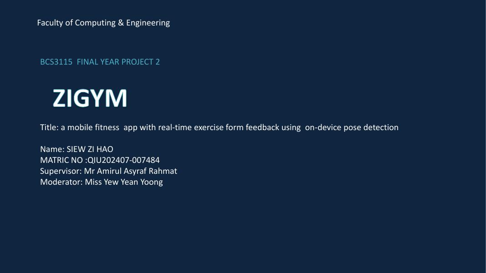
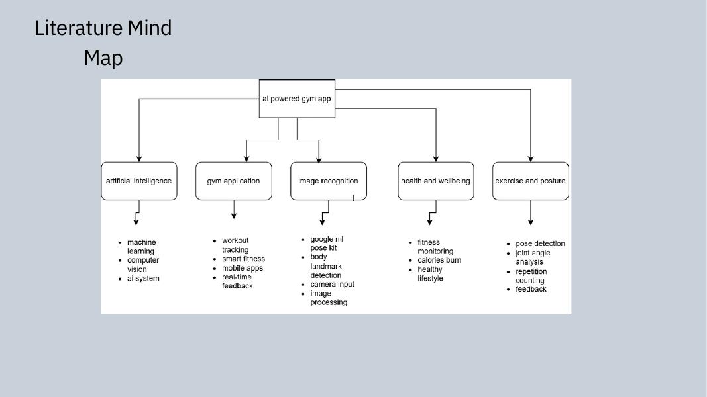
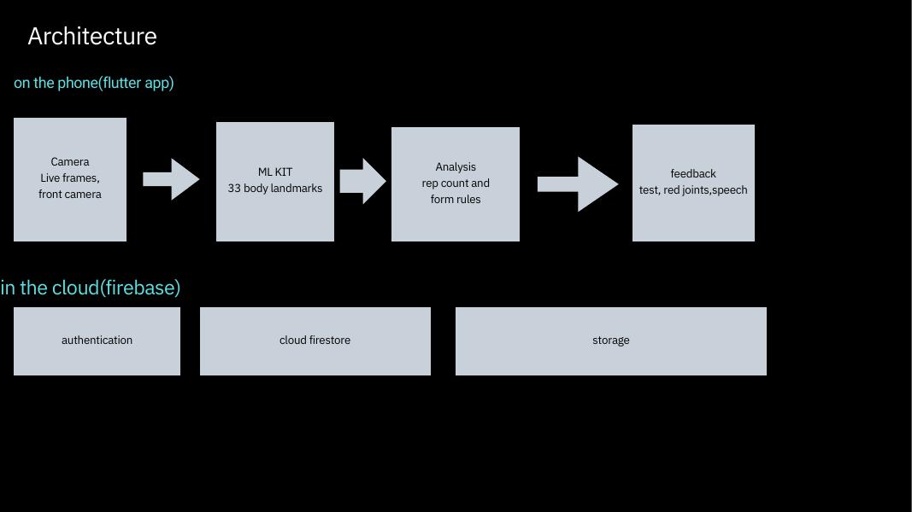
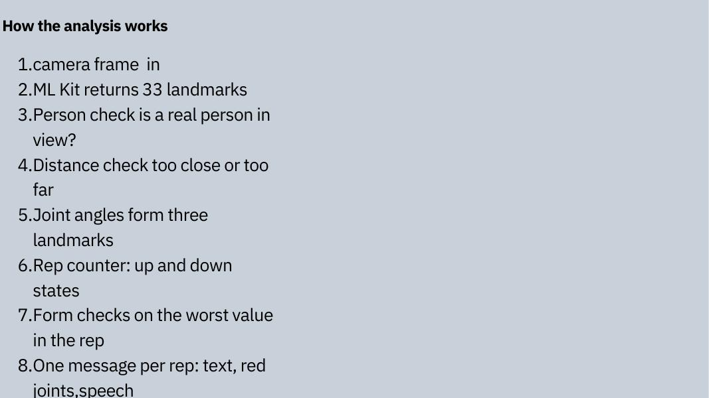
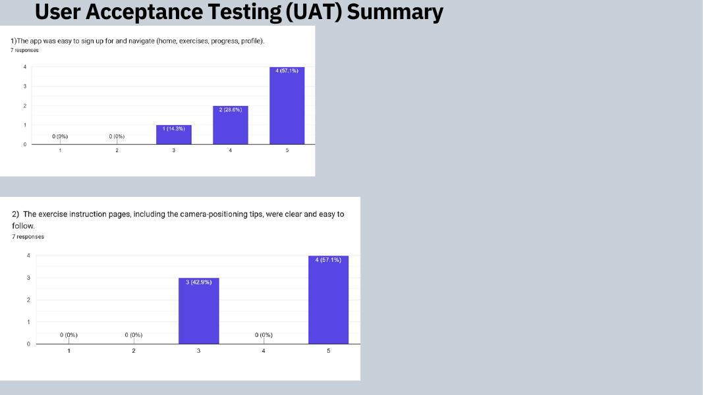
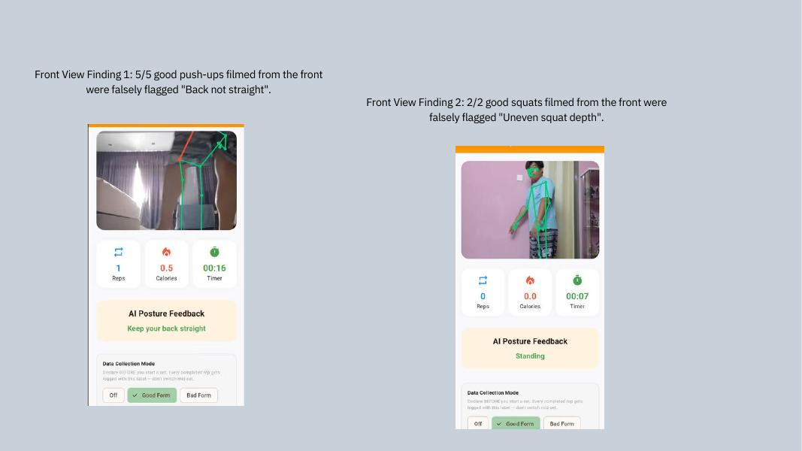

# ZiGym: A Mobile Fitness App with Real-Time Exercise Form Feedback Using On-Device Pose Detection

**BCS3115 Final Year Project 2** · Faculty of Computing & Engineering

| | |
|---|---|
| **Student** | Siew Zi Hao |
| **Matric No.** | QIU202407-007484 |
| **Supervisor** | Mr Amirul Asyraf Rahmat |
| **Moderator** | Miss Yew Yean Yoong |

## Contents

1. [Introduction](#chapter-1-introduction)
2. [Literature Review](#chapter-2-literature-review)
3. [Methodology](#chapter-3-methodology)
4. [Implementation and Testing](#chapter-4-implementation-and-testing)
5. [Conclusion](#chapter-5-conclusion)

---

## Chapter 1: Introduction

### Problem Statement

- **No coach, no feedback:** People exercise alone and may not notice bad form, such as a sagging back in a push-up.
- **Apps log, they don't watch:** Most fitness apps record workouts by hand and never check how the movement was done.
- **Special hardware:** Camera-based systems need smart mirrors or extra computing, which adds cost.
- **Conditions matter:** Lighting, camera angle and hidden body parts all change how accurate the analysis is.

### Objectives

1. **Pose:** Count reps for push-ups, squats and jumping jacks, and time plank holds, using on-device detection.
2. **Form:** Check form with rule-based analysis and give real-time visual and text feedback.
3. **Progress:** Provide a workout summary, progress tracking and recommendations in a user account.
4. **Evaluation:** Evaluate through manual testing, a new-user test and a survey, and report limits honestly.

> TODO: add the reason the scope was narrowed from food and calorie tracking to form feedback (marked "[Your reason]" on slide 5 of the deck).

---

## Chapter 2: Literature Review

### Related Work

| System | Strength | Gap |
|---|---|---|
| MyFitnessPal | Large food database | Manual logging |
| Nike Training Club | Professional workout plans | No real-time posture check |
| Virtual gym assistant | Real-time posture monitoring | Limited exercise variety |
| Smart mirror | Interactive posture feedback | Expensive hardware |
| **ZiGym** | Real-time form feedback with a phone camera | Few exercises; camera angle matters |

---

## Chapter 3: Methodology

### Development Phases

| Phase | What was done in ZiGym |
|---|---|
| Project planning | Set goals, scope and tools; scope later narrowed to form feedback |
| Requirement analysis | Functional and non-functional requirements |
| System design | Architecture, database, screens and form analysis algorithm |
| Prototype development | Flutter app, ML Kit pose detection, form rules and Firebase, built in stages |
| System integration | Camera, analysis, feedback, recording and storage joined into one flow |
| Testing and evaluation | Manual test, a new-user test, phone recordings and a survey |
| Final implementation | Fixed issues, finalised the app and wrote the documentation |

### Architecture

**On the phone (Flutter app)**

- **Camera:** live frames, front camera by default.
- **ML Kit:** 33 body landmarks.
- **Analysis:** rep count and form rules.
- **Feedback:** text, red joints and speech.

**In the cloud (Firebase)**

- Authentication
- Cloud Firestore
- Storage

### How the Analysis Works

1. Camera frame in.
2. ML Kit returns 33 landmarks.
3. **Person check:** is a real person in view?
4. **Distance check:** too close or too far.
5. **Joint angles** from three landmarks.
6. **Rep counter:** up and down states.
7. **Form checks** on the worst value in the rep.
8. One message per rep: text, red joints and speech.

### System Deployment

ZiGym runs as an Android app on the user's phone.

- **Frontend:** Flutter and Dart
- **Pose detection:** Google ML Kit, on the device
- **Camera:** Flutter `camera` package, front camera by default
- **Speech:** `flutter_tts` for spoken feedback
- **Backend:** Firebase Authentication, Cloud Firestore and Storage

### Pose Detection and Rep Counting

- ML Kit returns 33 landmarks on every camera frame.
- **Person check:** nose, shoulder, hip and knee on one side must be confident and look human. This stops objects such as toys from being counted.
- **Distance check:** body size against the frame, with "move closer" and "step back" messages.
- **Joint angles** are calculated from three landmarks, using the more visible side.
- **Rep counter:** up and down states with a 300 ms minimum between reps. Plank is timed.

### Form Checks

| Exercise | Check | Rule |
|---|---|---|
| Push-up | Rep | Elbow angle 155° up, 90° down |
| Push-up | Alignment | Shoulder–hip–ankle at least 160° |
| Squat | Rep | Knee angle 160° up, 100° down |
| Squat | Torso | Lean at least 45° |
| Jumping jack | Leg spread | Ratio at least 1.4 |
| Plank | Hip direction | Hips against the shoulder–ankle line (160° or more is good) |
| Push-up, squat | Symmetry | Left and right differ by more than 20° |
| All reps | Tempo | Rep faster than 600 ms is flagged |

**Priority rule:** one issue per rep, evaluated in order: posture, then symmetry, then tempo.

---

## Chapter 4: Implementation and Testing

### Demo Sequence

1. Pick push-up and read the camera tip.
2. Three good reps: the counter goes up.
3. One bad rep: red joints and a spoken message.
4. Finish: summary, then progress.

### Summary, Progress and Recommendations

- **Workout summary:** reps or hold time, duration, estimated calories and form issues found.
- **Recordings:** up to five per user, played back with the skeleton overlay.
- **Progress:** history, weekly chart and achievements (a new account starts empty).
- **Recommendations:** triggered after three workouts (consistency, focus area, trend and neglected exercises).
- **Calories:** a flat estimate per rep or per minute held.

### Testing and Issues Found

**12 issues found and fixed:** 1 critical, 4 high, 5 medium, 2 low.

- **High:** a pillow, bolster or toy was counted as a person.
- **Critical:** logout crash from a null check.
- **High:** new accounts showed fake achievements.
- **Medium:** the rear camera opened by default.

### Functional Test Cases

| Test case | Result |
|---|---|
| Sign up with the same password typed twice | Failed at first; fixed and passed |
| Log out while the Progress tab is open | Crashed at first; fixed and passed |
| Open a brand-new account with no workouts | Showed fake achievements; fixed |
| Start workout and check camera | Rear camera at first; front camera now |
| Place a pillow or toy in frame | Ignored; rep counter stayed at 0 *(confirm retest result)* |
| Good-form push-up filmed from the front | Falsely flagged (5 of 5) |
| Good-form push-up and squat filmed from the side | *(fill in result after retest)* |

### User Acceptance Testing (UAT) Summary

Survey of 7 respondents.

### Output Analysis

| Output | Observed | Interpretation |
|---|---|---|
| Rep count | Matched in most sets; mismatches mostly at very fast speeds | The minimum-interval check filters noise |
| Form classification | Depends heavily on camera angle; front-view good reps were flagged | Side view is needed for alignment checks |
| Person check | A pillow or toy in frame was no longer counted as a person, and the rep counter stayed at 0 | Stops false counting when nobody is in view |
| Feedback delivery | Text, red joints and speech seen in phone recordings | Messages tie directly to joints the user can see |

### Front-View Findings

- **Finding 1:** 5/5 good push-ups filmed from the front were falsely flagged "Back not straight".
- **Finding 2:** 2/2 good squats filmed from the front were falsely flagged "Uneven squat depth".

### Findings Against Objectives

| Objective | Finding |
|---|---|
| Count reps and time plank holds | Counts matched in most sets; mismatches were mostly at very fast speed |
| Rule-based form feedback | Works in side view; front-view good push-ups (5/5) and squats (2/2) were falsely flagged |
| Summary, progress and recommendations | Implemented; recommendations require at least three workouts |
| Evaluation | 12 issues found and fixed; survey with 7 respondents |

### Constraints and Limitations

**Constraints**

- One semester of development
- Android only, tested on HONOR 400 Pro
- Small-scale testing, no labelled dataset
- Single 2D camera view
- Firebase free plan *(confirm)*

**Limitations**

- Accuracy depends on camera angle and lighting
- Thresholds are estimates, not validated
- Few exercises, one person at a time
- Calories are approximate
- Not a trainer or a doctor

---

## Chapter 5: Conclusion

### Project Contributions

- **Integrated workout app:** combines pose detection, rep counting, form feedback, recording, progress and recommendations in one Android app.
- **Explainable form feedback:** every message stems from a measured rule and runs on the phone.
- **Reliability checks:** person and distance checks prevent false counting.
- **An honest test:** highlights where the rules fail, with camera angle being the primary finding.
- **Requirement-linked testing:** 12 issues found and fixed, backed by recordings as evidence.

### Future Enhancements

| Enhancement | Intended improvement |
|---|---|
| Trained form classifier (data collection mode) | Reduces reliance on hand-set thresholds |
| More exercises | Expands workout coverage |
| Per-user calibration | Fits different body sizes and ranges of motion |
| Automatic camera-angle detection | Avoids false flags caused by front-view placement |
| Offline sync | Saves workouts offline and uploads later |

### Conclusion

- ZiGym counts reps and gives real-time form feedback via a phone camera, with all analysis running on-device.
- Rule-based checks make every message explainable through actual measurements.
- Testing identified 12 issues (all fixed), with camera angle proving to be the primary factor determining accuracy.
- Side view is recommended, though thresholds still require validation with labelled data.
